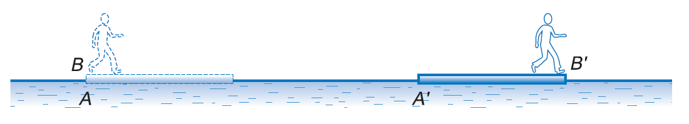
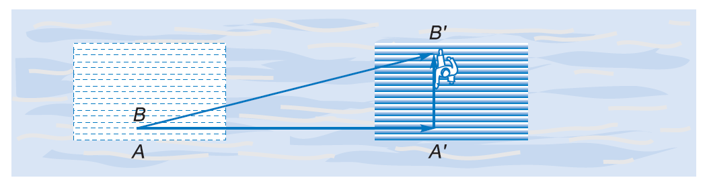
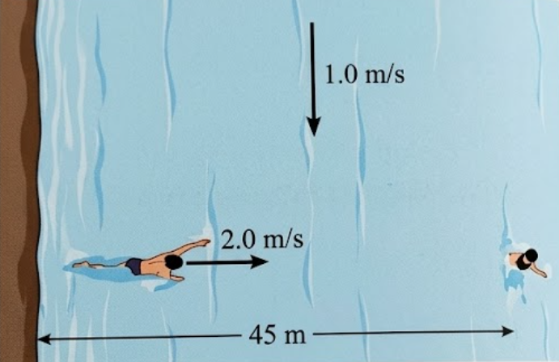
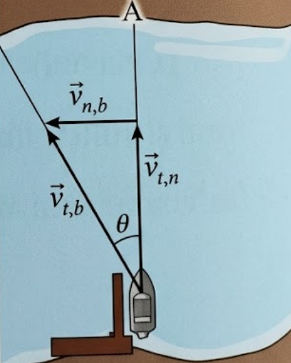
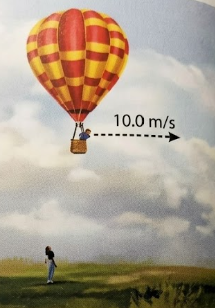
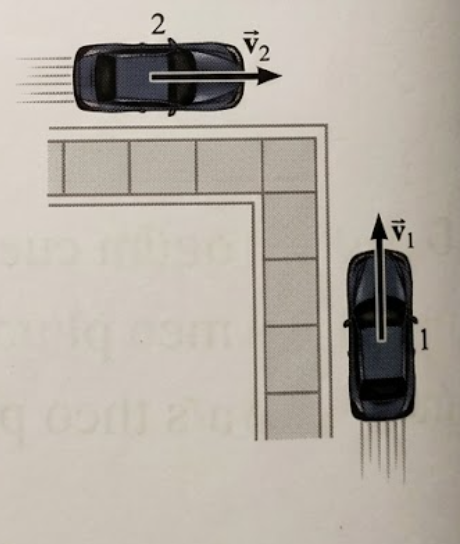

## Tính tương đối của chuyển động - Công thức cộng vận tốc

Ta có:

- $\overrightarrow{AB^{\prime}}$ là độ dời của người đối với bờ, là độ dời tuyệt đối.
- $\overrightarrow{A^{\prime} B^{\prime} }$ là độ dời của người đối với bè, là độ dời tương đối.
- $\overrightarrow{AA^{\prime} }$ là độ dời của bè đối với bờ, là độ dời kéo theo.

Độ dời của người đối với bờ là:
$$
  \overrightarrow{AB^{\prime} } = \overrightarrow{AA^{\prime} } + \overrightarrow{A^{\prime} B^{\prime} }
$$
Chia cả hai vế cho $\Delta t$, ta được:
$$ \vec{v}_{1,3} = \vec{v}_{1,2} + \vec{v}_{2,3} $$
trong đó

- $\vec{v}_{1,3}$ là vận tốc của người so với bờ, là vận tốc tuyệt đối.
- $\vec{v}_{1,2}$ là vận tốc của bè so với bờ, là vận tốc tương đối.
- $\vec{v}_{2,3}$ là vận tốc của người so với bè, là vận tốc kéo theo.

Các trường hợp đặc biệt:

- Khi $\vec{v}_{12}$ và $\vec{v}_{23}$ cùng chiều: $v_{13} = v_{12} + v_{23}$
- Khi $\vec{v}_{12}$ và $\vec{v}_{23}$ ngược chiều: $v_{13} = \vert v_{12} + v_{23} \vert$
- Khi $\vec{v}_{12}$ và $\vec{v}_{23}$ vuông góc nhau: $v_{13}^2 = v_{12}^2 + v_{23}^2$

::: {.callout}

**Ví dụ 1**. Một chiếc thuyền đang chuyển động với vận tốc 1.7 m/s so với mặt nước. Một hành khách đang đi lên cầu thang của thuyền với vận tốc tốc 0.6 m/s so với thuyền. Cầu thang nghiêng một góc $45^\circ$. Tìm độ lớn vận tốc của hành khách so với mặt nước.

**Ví dụ 2**. Một bè gỗ đang trôi trên dòng sông với vận tốc 1.5 m/s, một người đi trên bè với vận tốc 0.7 m/s so với bè gỗ theo hướng vuông góc với hướng trôi của bè. Tìm vector vạn tốc tương đối của người so với bờ sông.

**Ví dụ 3**. Một người đi bộ về đầu tàu hoả với vận tốc 5 km/h so với tàu hoả. Trong khi tàu hoả đang chạy với vận tốc 80 km/h so với mặt đất. Tính vận tốc tương đối của người so với mặt đất.

**Ví dụ 4**. Một con thuyền có vận tốc so với nước yên lặng là 1.85 m/s, vận tốc của nước so với bờ sông là 1.2 m/s và chảy theo hướng Đông - Tây như hình vẽ, bề rộng của sông là 200 m.\
a. Hỏi để thuyền qua sông theo hướng Nam - Bắc để cập bến tại A thì người lái thuyền phải hướng mũi thuyền theo hướng nào, thời gian qua sông là bao lâu?\
b. Tính vận tốc tương đối của tàu so với bờ sông khi đó.

:::

### Bài tập tự luyện {.unnumbered}

<!-- Sách ôn luyện vật lý -->

::: {.columns}
::: {.column width="70%"}

**Bài 1**. Một đứa trẻ ở cách bờ sông một khoảng 45m và đang bị nước cuốn về phía hạ lưu với vận tốc 1,0 m/s. Khi đứa trẻ trôi ngang qua một nhân viên cứu hộ người này lập tức nhảy xuống nước và bơi theo đường thẳng vuông góc với bờ sông với vận tốc 2,0 m/s so với mặt nước để tiếp cận đứa trẻ. Hỏi sau bao lâu nhân viên cứu hộ đến được vị trí đứa trẻ và khi đó họ bị trôi đi bao xa về phía hạ lưu.

:::
::: {.column width="30%"}

:::
:::

::: {.columns}
::: {.column width="70%"}

**Bài 2**. Một người lái tàu luôn hướng mũi tàu vuông góc với bờ sông để băng qua một con sông rộng 110m, vận tốc của tàu so với nước yên lặng là 1,85 m/s, vận tốc dòng nước là 1,2 m/s.\
a. Tính vận tốc tương đối của tàu so với bờ sông.\
b. Hỏi tàu qua sông trong thời gian bao lâu và tàu bị trôi về phía hạ lưu một đoạn bao nhiêu so với bến dự định (tại A)?

:::
::: {.column width="30%"}

:::
:::

::: {.columns}
::: {.column width="70%"}

**Bài 3**. Một người đang ngồi trên một khinh khí cầu thì ném một quả bóng theo phương ngang với vận tốc 10 m/s so với khí cầu. Vận tốc (hướng, độ lớn) của quả bóng đối với một người đứng trên mặt đất là bao nhiêu nếu:\
a. Khinh khí cầu đang bay lên theo phương thẳng đứng với vận tốc 3 m/s.\
b. Khi khí cầu đang hạ xuống theo phương thẳng đứng với vận tốc 3 m/s.

:::
::: {.column width="30%"}

:::
:::

::: {.columns}
::: {.column width="70%"}

**Bài 4**. Hai ô tô cùng chạy đến một khúc cua như hình vẽ, vận tốc của xe 1 là 35km/h của xe 2 là 55km/h. Người ngồi trên xe 1 sẽ thấy xe 2 chạy theo hướng nào với vận tốc là bao nhiêu?

:::
::: {.column width="30%"}

:::
:::

::: {.columns}
::: {.column width="80%"}

**Bài 5**. Một ô tô chạy với vận tốc 50 km/h trong trời mưa. Mưa rơi theo phương thẳng đứng. Trên cửa kính bên của xe, các vệt mưa làm với phương thẳng đứng một góc 60°.\
a. Xác định vận tốc của giọt mưa đối với xe ô tô.\
b. Xác định vận tốc của giọt mưa đối với mặt đất.

:::
::: {.column width="20%"}

:::
:::

::: {.columns}
::: {.column width="80%"}

**Bài 6**. Từ một khinh khí cầu đang hạ thấp đều với vận tốc v₀ = 2 m/s (so với mặt đất), người ta phóng một vật thẳng đứng hướng lên với vận tốc v = 18 m/s (so với mặt đất). Lấy g = 10 m/s².\
a. Tính khoảng cách giữa khí cầu và vật khi vật lên tới vị trí cao nhất.\
b. Sau bao lâu vật rơi trở lại gặp khí cầu.

:::
::: {.column width="20%"}

:::
:::

<!-- Sách tham khảo vật lý 10 trang 24 -->
**Bài 7**. Một thang cuốn tự động đưa khách từ tầng trệt lên lầu trong 1 phút. Nếu thang ngừng thì khách phải đi bộ lên trong 3 phút. Hỏi nếu thang máy chạy mà khách vẫn bước lên sẽ mất thời gian bao lâu?

**Bài 8**. Một chiếc phà chạy xuôi dòng từ A đến B mất 2 giờ và đi ngược dòng mất 3 giờ. Hỏi nếu người ta tắt máy để cho phà trôi theo dòng nước thì nó trôi từ A đến B mất bao lâu?

**Bài 9**. Một ô tô đang chạy với vận tốc 54 km/h thì đuổi kịp một đoàn tàu đang chạy trên đwờng sắt song song với đường ô tô. Một hành khách ngồi trên ô tô nhận thấy từ lúc ô tô gặp đoàn tàu đến lúc vượt qua mất 30s. Đoàn tàu gồm 10 toa, mọt toa dài 15 m. Tìm vận tốc của đoàn tàu.

**Bài 10**. Một ca nô đi ngang qua sông, xuất phát từ điểm A, mũi hướng vào điểm B trên bờ sông bên kia. AB vuông góc với bờ sông. Nhưng do dòng nước chảy nên sau 100 s, ca nô đến vị trí C ở bờ bên kia cách B một đoạn BC = 200 m. Nếu người ta giữ cho mũi ca nô luôn hướng theo phương chếch với bờ sông góc $60^\circ$ thì ca nô sẽ sang đúng điểm B, hãy tìm:\
a. Vận tốc của dòng nước so với bờ sông.\
b. Vận tốc của ca nô so với dòng nước.\
c. Chiều rộng của dòng sông.\
d. Thời gian ca nô qua sông khi ca nô cập bến B.

**Bài 11**. Hai chiếc tàu chuyển động cùng vận tốc v hướng đến O theo quỹ đạo là những đường thẳng hợp với nhau một góc $60^\circ$. Xác định khoảng cách nhỏ nhất giữa các tàu. Biết ban đầu chúng cách O lần nược là 20 km và 30 km.
